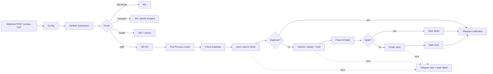

# n8n Lead Follow-up: Webhook → Google Sheets → OpenAI → Gmail → Telegram

An n8n workflow you can import as-is. When someone submits a website contact form, it:

1. **Saves the lead** to Google Sheets
2. **Writes a short, personalized follow-up email** with OpenAI, based on what the lead wrote
3. **Sends that email** from your Gmail account
4. **Notifies you on Telegram** with the lead's details and a preview of the email that was sent

It also handles the problems a real contact form runs into: bots, spam, repeat submissions, prompt injection and API outages.



## Edge cases handled

| Situation | What happens |
|---|---|
| Missing or wrong `X-Form-Secret` header | `401`, nothing is saved |
| Honeypot field `website` is filled in (bot) | `200` so the bot learns nothing; dropped without saving |
| Invalid email, missing name/message, message over 5,000 chars | `400` with a readable `error` your form can show |
| Messy input (extra spaces, uppercase email, HTML tags) | Cleaned: trimmed, email lowercased, tags and control characters stripped |
| Same email already got a follow-up in the last 7 days | Logged as `Duplicate – no email`, you're notified, no second email goes out |
| Spam or sales pitch that gets past the honeypot | OpenAI flags it: logged as `Spam – no email`, you're notified so you can double-check |
| Prompt injection ("ignore previous instructions…") | The message is passed to OpenAI as delimited, untrusted data; the prompt bans prices, discounts and promises |
| Lead writes in another language | The reply is written in the same language |
| OpenAI returns malformed output | A safe template email is used instead and the row is noted |
| OpenAI, Gmail or Sheets is down or the auth has expired | Retries twice more, then marks the row as failed and sends you a ⚠️ Telegram alert with the full lead details, so no lead is lost |
| Telegram is down | Doesn't break the run; everything else still completes |
| Slow APIs | The form gets its `200` immediately, before any API calls run |
| Special characters in the lead's details | Escaped for Telegram HTML, so they can't break the notification |
| Formula injection (`=HYPERLINK(...)` typed into the form) | Rows are written as RAW values, so Sheets never runs them as formulas |
| Double-click / resubmitting while the first is still processing | Counted as a duplicate (`New` rows count too) |
| A previous attempt failed | Not treated as a duplicate, so resubmitting gets a reply |
| Very long messages | Only the first `aiMaxChars` go to OpenAI; the Telegram message is trimmed to stay under its 4,096-character limit |

## Setup (about 15 minutes)

### 1. Google Sheet
Create a sheet with a tab named **`Leads`** and paste the header row from [`sheet-template.csv`](sheet-template.csv):

```
Lead ID, Submitted At, Name, Email, Phone, Company, Message, Status, Spam Flag, Notes
```

Copy the sheet ID from its URL: `docs.google.com/spreadsheets/d/<THIS_PART>/edit`.

### 2. Telegram bot
1. Message [@BotFather](https://t.me/BotFather), run `/newbot`, and copy the bot token.
2. Send your new bot any message, then open `https://api.telegram.org/bot<TOKEN>/getUpdates` and copy `message.chat.id`. That's your chat ID.

### 3. Import the workflow
In n8n, go to **Workflows → Import from File** and choose [`workflow/lead-followup.json`](workflow/lead-followup.json).

### 4. Credentials
Open each node marked with a red warning and create or select a credential:

| Node(s) | Credential |
|---|---|
| Find Previous Leads, Save Lead, Mark Spam, Mark Sent, Mark Failed | Google Sheets OAuth2 |
| Draft Follow-up (OpenAI) | OpenAI API key |
| Send Follow-up (Gmail) | Gmail OAuth2 |
| Notify Owner (Telegram) | Telegram API (bot token) |

### 5. Edit the `Config` node
All the business-specific values live in one place:

| Field | Example |
|---|---|
| `businessName` | `Rolle Web Studio` |
| `ownerEmail` | Reply-to address for follow-ups |
| `telegramChatId` | From step 2 |
| `sheetId` | From step 1 |
| `formSecret` | Any long random string (leave empty to turn the check off) |
| `duplicateWindowDays` | `7` |
| `maxMessageLength` | `5000` |
| `aiMaxChars` | `2000` (how much of the message is sent to OpenAI) |
| `openAiModel` | `gpt-4o-mini` |
| `businessContext` | One or two sentences about what the business does, so replies stay on topic |

### 6. Activate
Toggle the workflow to **Active**. The production URL is shown on the **Contact Form Webhook** node:
`https://<your-n8n>/webhook/contact-form`

## Connecting your website
[`examples/contact-form.html`](examples/contact-form.html) is a working form that includes the hidden honeypot field and the secret header. The webhook accepts JSON or regular form posts with these fields:

| Field | Required |
|---|---|
| `name` | yes |
| `email` | yes |
| `message` | yes |
| `phone` | no |
| `company` | no |
| `website` | honeypot: leave it hidden and empty |

> **Security note:** a secret placed in browser JavaScript can be seen by anyone who views the page source. It stops random POSTs to your webhook URL, and together with the honeypot and AI spam check that covers most spam. For stronger protection, send the form through your site's own backend (or a serverless function) so the secret never reaches the browser. If you serve the form from your own domain, also set **Allowed Origins** on the webhook node.

## Testing

```bash
URL=http://localhost:5678/webhook-test/contact-form   # "Listen for test event" URL
SECRET=change-me

# ✅ valid lead → 200
curl -s -X POST $URL -H 'Content-Type: application/json' -H "X-Form-Secret: $SECRET" -d @examples/payloads/valid.json

# 🔒 no secret → 401
curl -s -X POST $URL -H 'Content-Type: application/json' -d @examples/payloads/valid.json

# ❌ invalid → 400
curl -s -X POST $URL -H 'Content-Type: application/json' -H "X-Form-Secret: $SECRET" -d @examples/payloads/invalid-email.json
```

Other payloads in [`examples/payloads/`](examples/payloads/):
- `honeypot.json`: bot submission, silently dropped
- `spam.json`: sales pitch, flagged by the AI
- `prompt-injection.json`: tries to hijack the AI
- `non-english.json`: Spanish lead, gets a Spanish reply
- `too-long.json`: over the length limit
- `missing-fields.json`: empty name and message

Submit `valid.json` twice to test duplicate detection.

### Automated checks

```bash
node scripts/validate-workflow.mjs   # structure: connections, node references, no leaked keys
node scripts/test-code-nodes.mjs     # logic: duplicates, AI parsing/fallback, escaping, alerts
```

### Run n8n locally

```bash
docker compose up -d   # http://localhost:5678
docker compose exec n8n n8n import:workflow --input=/workflow/lead-followup.json
```

Tested on n8n **2.45.6**. The OpenAI node uses v1.8 (Chat Completions), which also runs on recent n8n 1.x.

## Files

```
workflow/lead-followup.json     ← the n8n workflow (import this)
sheet-template.csv              ← Google Sheet header row
examples/contact-form.html      ← drop-in website form
examples/payloads/*.json        ← test submissions
scripts/validate-workflow.mjs   ← checks the exported JSON
scripts/test-code-nodes.mjs     ← tests the Code-node logic
docker-compose.yml              ← local n8n
```

## License
MIT
